  

  
  
  
  

  

  

  

<!-- P/01 -->

  
  

  &nbsp;
  

 

<!-- P/02 -->

  
  

  &nbsp;
  

 

<!-- P/03 -->

  
  

  &nbsp;
  

 

<!-- P/04 -->

  
  

  &nbsp;
  

  
  

  <picture>
    <source media="(prefers-color-scheme: dark)" srcset="https://raw.githubusercontent.com/GurkanGurdal/GurkanGurdal/output/github-snake-dark.svg">
    
  </picture>

  

