

  

  <a href="#hakkimda">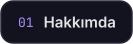</a>
  <a href="#teknolojiler">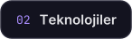</a>
  
  <a href="#github">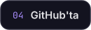</a>
  <a href="#iletisim">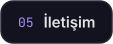</a>

  

  

<!-- P/01 -->

  
  

  &nbsp;
  

 

<!-- P/02 -->

  
  

  

 

<!-- P/03 -->

  
  

  

 

<!-- P/04 -->

  
  <a href="https://github.com/BurakYucelPY/AquaSmart">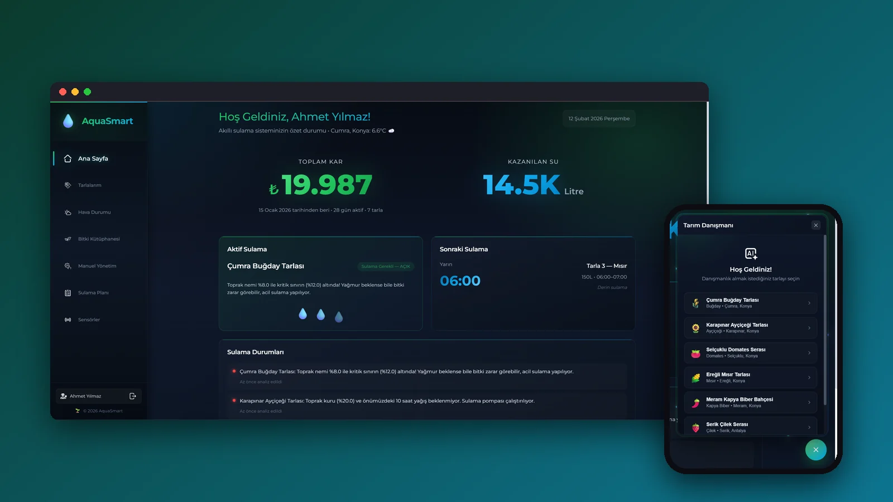</a>

  

 

<!-- P/05 -->

  
  

  &nbsp;
  

  

  <a href="https://www.linkedin.com/in/g%C3%BCrkan-g%C3%BCrdal-1597ba35a/"></a>
  <a href="mailto:grkngurdal@gmail.com?subject=Merhaba%20G%C3%BCrkan"></a>

  

