  

  
  <!-- İletişim rozeti eklemek istersen: E-POSTA_ADRESIN kısmını değiştirip yorum işaretlerini kaldır
  
  -->
  <!-- LinkedIn:  -->

## 👋 Merhaba, ben Gürkan

Bilgisayar mühendisiyim; **web siteleri ve mobil uygulamalar** geliştiriyorum. En çok keyif aldığım yer **frontend**: bir fikri, ekranda iyi görünen ve iyi hissettiren bir arayüze dönüştürmek. Tasarımda sade ama sıradan olmayanı, **modern ve yaratıcı** olanı arıyorum.

- 🎨 Arayüz tasarımı ve etkileşim — animasyon, mikro etkileşimler, responsive düzenler
- 🌐 Web ve 📱 mobil — aynı özeni her ekran boyutuna taşımak
- 🎬 Şu sıralar **AI Film & Dizi Öneri** projemi geliştiriyorum
- 🏆 **BTK Akademi Ankara AI Hackathon 2026**'da takımla **AquaSmart** akıllı sulama sistemini geliştirdik

## 🧰 Kullandığım Teknolojiler

  

## 🚀 Öne Çıkan Projeler

<table>
  <tr>
    <td width="50%" valign="top">
      
      <h3>🎬 AI Film & Dizi Öneri</h3>
      
Ruh haline ve zevkine göre film/dizi öneren yapay zekâ asistanı. TMDB entegrasyonu, kişisel kütüphane, doğal dil istekleri.

      
      
      
        
      <a href="https://gurkangurdal.github.io/Dizi_Film_AI_Oneri/"><b>▶ Canlı Demo</b></a> · <a href="https://github.com/GurkanGurdal/Dizi_Film_AI_Oneri">Kaynak Kod</a>
    </td>
    <td width="50%" valign="top">
      
      <h3>🎮 2 Kişilik Oyunlar</h3>
      
Aynı klavyede oynanan 14 oyun: Kafa Topu, Air Hockey, Tank Savaşı, Bilardo, Kovboy Düellosu ve dahası.

      
      
        
      <a href="https://gurkangurdal.github.io/2-Kisilik-Oyunlar-web-sitesi/"><b>▶ Hemen Oyna</b></a> · <a href="https://github.com/GurkanGurdal/2-Kisilik-Oyunlar-web-sitesi">Kaynak Kod</a>
    </td>
  </tr>
  <tr>
    <td width="50%" valign="top">
      
      <h3>⚽ En-Nesyri'yi Fırlat!</h3>
      
Mancınıkla golcüyü Arabistan'a fırlat. Güç barı, fizik motoru, parçacık efektleri ve Web Audio sesleri.

      
      
        
      <a href="https://gurkangurdal.github.io/En-Nesryi-yi-firlat-oyunu/"><b>▶ Hemen Oyna</b></a> · <a href="https://github.com/GurkanGurdal/En-Nesryi-yi-firlat-oyunu">Kaynak Kod</a>
    </td>
    <td width="50%" valign="top">
      
      <h3>🏡 Gürdal Emlak</h3>
      
SOLID prensipleriyle modüler yazılmış kurumsal emlak sitesi: filtreli ilan arama, detay sayfası, form doğrulama.

      
      
        
      <a href="https://gurkangurdal.github.io/G-rdal-Emlak-Web-Sitesi/"><b>▶ Canlı Demo</b></a> · <a href="https://github.com/GurkanGurdal/G-rdal-Emlak-Web-Sitesi">Kaynak Kod</a>
    </td>
  </tr>
</table>

### 🤝 Takım Projesi

| Proje | Açıklama |
|---|---|
| [**AquaSmart**](https://github.com/BurakYucelPY/AquaSmart) | BTK Akademi 30 Saatlik Ankara AI Hackathon 2026'da geliştirilen yapay zekâ destekli akıllı sulama sistemi |

## 📊 GitHub İstatistikleri

  
  

  <picture>
    <source media="(prefers-color-scheme: dark)" srcset="https://raw.githubusercontent.com/GurkanGurdal/GurkanGurdal/output/github-snake-dark.svg">
    
  </picture>

  

